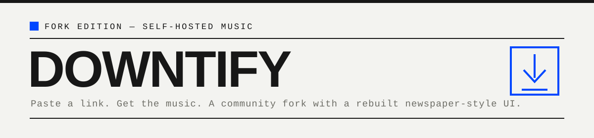
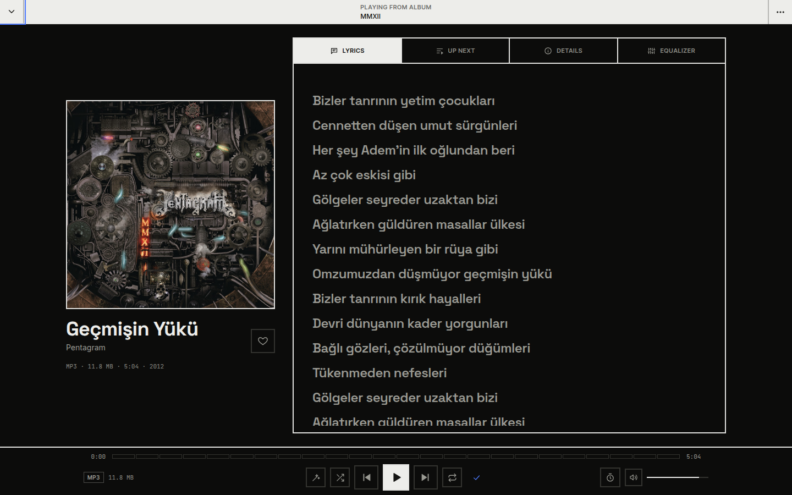
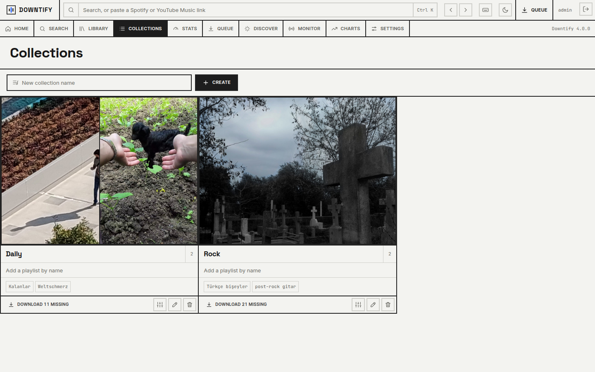
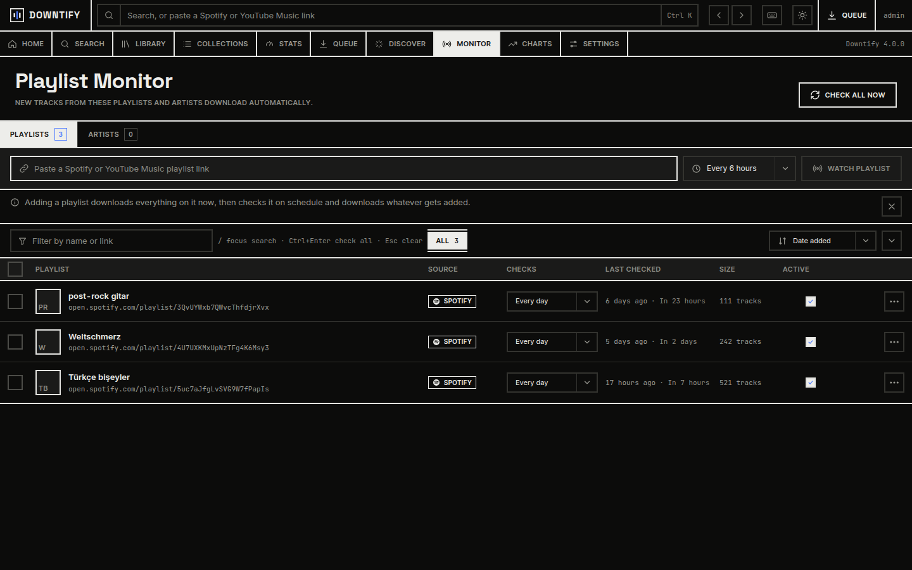
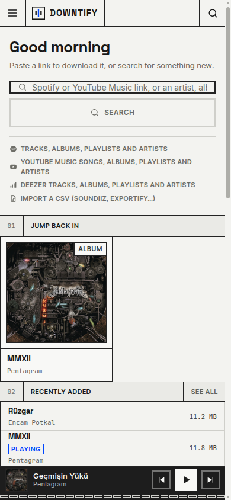

<p align="center">
  <picture>
    <source media="(prefers-color-scheme: dark)" srcset="assets/readme/wordmark-dark.svg">
    <source media="(prefers-color-scheme: light)" srcset="assets/readme/wordmark-light.svg">
    
  </picture>
</p>

<h3 align="center">A self-hosted music downloader and player, forked from <a href="https://github.com/henriquesebastiao/downtify">Downtify</a> with a rebuilt interface and a personal-server feature set.</h3>

<p align="center">
  Paste a Spotify, YouTube Music or Deezer link and build a tagged local library.
  <b>No Spotify account, API key or Premium is needed for link downloads.</b>
</p>

<p align="center">
  <a href="https://github.com/henriquesebastiao/downtify"></a>
  <a href="LICENSE"></a>
</p>

<p align="center">
  <a href="#whats-different"><b>Features</b></a> ·
  <a href="#quick-start"><b>Quick start</b></a> ·
  <a href="#spotify-connections"><b>Spotify connections</b></a> ·
  <a href="#stats-and-lastfm"><b>Stats</b></a> ·
  <a href="#documentation"><b>Documentation</b></a> ·
  <a href="#credits"><b>Credits</b></a>
</p>

<p align="center">
  
  <br><sub><b>Home</b> — the v4 Technical Gazette interface, with one accent color and a compact masthead.</sub>
</p>

## What's different

The fork keeps upstream's link resolver, YouTube Music matching, tagging, lyrics, player and playlist monitoring, then adds tools for running Downtify as a personal music server.

| Area        | Fork additions                                                                                                                                                                                                                                                                       |
| ----------- | ------------------------------------------------------------------------------------------------------------------------------------------------------------------------------------------------------------------------------------------------------------------------------------ |
| Downloading | Unified search, queue priority, quiet hours, bulk waiting-job controls, persistent failures with retry/exclude and optional [Spotify Sync](docs/features/spotify-sync.md) auto-downloads.                                                                                            |
| Library     | Smart [Collections](docs/features/collections.md) with grouped rules, previews and custom covers; read-only [Library Health](docs/features/library-health.md); storage tools; [Lyrics Health](docs/features/lyrics-health.md) with bounded gap filling and device-local sync offset. |
| Listening   | Cross-device Continue listening, a Last.fm + Downtify [Stats](docs/features/stats.md) profile, Last.fm [scrobbling/history import](docs/features/scrobbling.md) and optional [Spotify Mirror](docs/features/spotify-mirror.md).                                                      |
| Automation  | Playlist and artist [monitoring](docs/features/playlist-monitor.md), one-click artist watching, Similar bulk downloads, multi-channel [notifications](docs/features/notifications.md) and read-only Telegram commands.                                                               |
| Safety      | Atomic metadata [backups](docs/features/backups.md) with safe restore, redacted health exports and explicit [storage](docs/features/storage.md) controls.                                                                                                                            |
| Interface   | Responsive v4 UI with light/dark themes, keyboard-aware controls, reduced-motion support and an installable PWA. See [DESIGN.md](DESIGN.md).                                                                                                                                         |

### The v4 interface

<p align="center">
  
  <br><sub><b>Now Playing</b> — the transport strip stays pinned to the bottom of every page.</sub>
</p>

<p align="center">
  
  
  <br><sub><b>Library</b> keeps cover art colorful. <b>Collections</b> groups playlists behind reusable rules.</sub>
</p>

<p align="center">
  
  
  <br><sub><b>Monitor</b> keeps watch rows compact. <b>Mobile</b> collapses navigation into a block menu.</sub>
</p>

The design language is documented in [DESIGN.md](DESIGN.md): paper `#F3F3F0`, ink `#171717`, one accent `#0047FF`, 2-px hairlines, no radius and no shadows.

## Quick start

You need [Docker](https://docs.docker.com/get-docker/) and [Git](https://git-scm.com/downloads). This fork does not publish a ready-made image; build it from source:

```bash
git clone https://github.com/hereticloner/downtify-fork.git
cd downtify-fork
docker compose up -d --build downtify
```

Open **[localhost:8000](http://localhost:8000)** and sign in as **`admin`** / **`downtify`**. Change that password immediately in **Settings → General**.

Keep both persistent directories on durable storage:

- `docker/downloads` — downloaded audio and embedded artwork.
- `docker/data` — settings, databases, caches and backups.

If you expose Downtify beyond localhost, keep authentication enabled and put it behind an HTTPS reverse proxy. For an instance reachable only by you or behind another authenticated proxy, `DOWNTIFY_DISABLE_AUTH=true` can turn off Downtify's own sign-in; see [Users & Sign-in](docs/features/users.md#turning-accounts-off). Never use that on an untrusted network.

The optional `mirror` service is not started by the command above; see [Spotify connections](#spotify-connections).

Prefer official releases, one-click app-store installs or ready-made multi-architecture images? Use the [original Downtify](https://github.com/henriquesebastiao/downtify#quick-start). This fork tracks upstream selectively, not release by release.

## Spotify connections

There are two separate things to understand: **downloading from Spotify links** and **connecting your Spotify account**.

### Downloading from links — no account required

Pasting a Spotify track, album, playlist or artist link does **not** require a Spotify login, Spotify Premium, a developer app or API credentials. Downtify reads public metadata and finds the audio through YouTube Music, with YouTube as fallback. Spotify is not the audio source.

### Optional Spotify Mirror — Premium account required

Spotify Mirror makes plays started in Downtify appear as real listening in your Spotify account. It uses a Spotify Connect device on your own **Spotify Premium** account; the packaged device is silent, so you continue listening in Downtify.

1. Create your own app at [Spotify for Developers](https://developer.spotify.com/dashboard) with the **Web API** option.
2. Add this Redirect URI to the app, using the address your browser uses to reach Downtify:
   `http://<your-server>:8000/integrations/spotify/callback`
   For a public HTTPS deployment, use that HTTPS URL instead. The value must match exactly.
3. In **Settings → Spotify Mirror**, enable the mirror, paste the app's **client ID** and Redirect URI, then choose **Connect with Spotify**. The PKCE flow does not need a client secret.
4. Choose **Load devices**, select your Connect device and run **Test connection**.

You can use an existing Spotify Connect device such as desktop or mobile Spotify. The packaged **Downtify Mirror** device is optional.

#### Packaged Downtify Mirror device

The included `mirror` service runs Spotify Soloist as a silent Connect device. It is currently **x86-64 only** and needs a Soloist API key:

1. Generate a key in the [Spotify Soloist dashboard](https://developer.spotify.com/dashboard/soloist) and add `SOLOIST_API_KEY=...` to your `.env` file.
2. Build and pair it once from a Spotify app on the same local network:

   ```bash
   docker compose build mirror
   docker compose run --rm mirror pair
   docker compose up -d mirror
   ```

3. Select **Downtify Mirror** in **Settings → Spotify Mirror**.

The pairing session lives in the `soloist_data` volume. Soloist builds expire after 90 days; renew with `docker compose build --no-cache mirror` before then. Full details: [Spotify Mirror](docs/features/spotify-mirror.md) and [Server Settings](docs/features/server.md#the-downtify-mirror-device).

### Optional Spotify Sync

[Spotify Sync](docs/features/spotify-sync.md) keeps downloaded Spotify playlists' membership up to date. It reuses the Mirror OAuth connection, so there is no second sign-in. Enable it in **Settings → Spotify Sync** after connecting Spotify.

The first sync records a baseline and downloads nothing. **Auto-download new additions** is off by default. If an older connection gets `403 Insufficient client scope`, use **Reconnect with Spotify** so the playlist scopes can be granted.

> [!NOTE]
> Spotify Mirror and Spotify Sync are optional. Neither is required to download pasted links, and neither is required for the Stats page.

## Stats and Last.fm

The Stats page at `/library/stats` is a personal listening profile built from **Downtify playback + Last.fm scrobbles only**. Spotify-only plays remain in the raw history archive for deduplication and metadata, but are excluded from every Stats aggregate and list.

Connect Last.fm under **Settings → Scrobbling** to scrobble new Downtify plays and import existing history. Older scrobbles are imported backwards in bounded pages and resume after a restart or API failure. See [Stats](docs/features/stats.md) and [Scrobbling](docs/features/scrobbling.md).

## What you can paste in

| Input                                         | Example                             |
| --------------------------------------------- | ----------------------------------- |
| Spotify track, album, playlist or artist      | `open.spotify.com/track/…`          |
| YouTube Music song, album, playlist or artist | `music.youtube.com/playlist?list=…` |
| YouTube video                                 | `youtube.com/watch?v=…`             |
| Deezer track, album, playlist or artist       | `deezer.com/album/…`                |
| Free-text search                              | `The Night Owls Do I Still Recall`  |
| Library export (CSV)                          | Soundiiz, TuneMyMusic, Exportify    |

The full pipeline is documented upstream: [How it works](https://downtify.henriquesebastiao.com/how-it-works/).

## Documentation

Fork-specific references live next to the code:

- [Collections](docs/features/collections.md) · [Smart Collections](docs/features/smart-collections.md)
- [Stats](docs/features/stats.md) · [Scrobbling](docs/features/scrobbling.md)
- [Notifications](docs/features/notifications.md) · [Backups](docs/features/backups.md)
- [Download Queue](docs/features/download-queue.md) · [Library Health](docs/features/library-health.md)
- [Lyrics Health](docs/features/lyrics-health.md) · [Storage](docs/features/storage.md)
- [Spotify Mirror](docs/features/spotify-mirror.md) · [Spotify Sync](docs/features/spotify-sync.md)
- [Monitor](docs/features/playlist-monitor.md) · [Server Settings](docs/features/server.md)

For behavior shared with upstream, use the official [getting started](https://downtify.henriquesebastiao.com/getting-started/), [feature reference](https://downtify.henriquesebastiao.com/features/), [troubleshooting](https://downtify.henriquesebastiao.com/troubleshooting/) and [API reference](https://downtify.henriquesebastiao.com/api-reference/) pages.

The upstream mobile apps speak the same API and can be pointed at this fork: [Downtify for Android](https://github.com/henriquesebastiao/downtify-android) and [Downtify for iOS](https://github.com/michaelmoskie/Downtify-IOS-Client).

## Credits

This fork exists because [Henrique Sebastião](https://github.com/henriquesebastiao) built and maintains [Downtify](https://github.com/henriquesebastiao/downtify) in the open, along with its [35+ contributors](https://github.com/henriquesebastiao/downtify/graphs/contributors). General features, upstream bug reports and translations belong in the original repository. If Downtify has earned a place on your server, consider [starring](https://github.com/henriquesebastiao/downtify) or [sponsoring](https://github.com/sponsors/henriquesebastiao) the upstream project.

Issues and pull requests for this fork's v4 interface, Collections, Stats and other fork-specific features are welcome here.

## License

Licensed under [AGPL-3.0](LICENSE), like the project it comes from.

> [!WARNING]
> Users are responsible for their actions and any legal consequences. Downtify does not support unauthorized downloading of copyrighted material and takes no responsibility for user actions.
