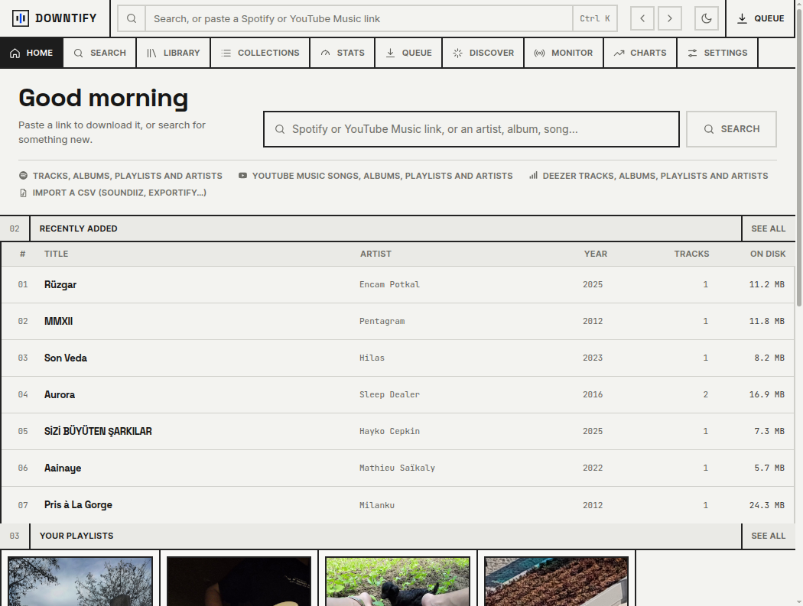
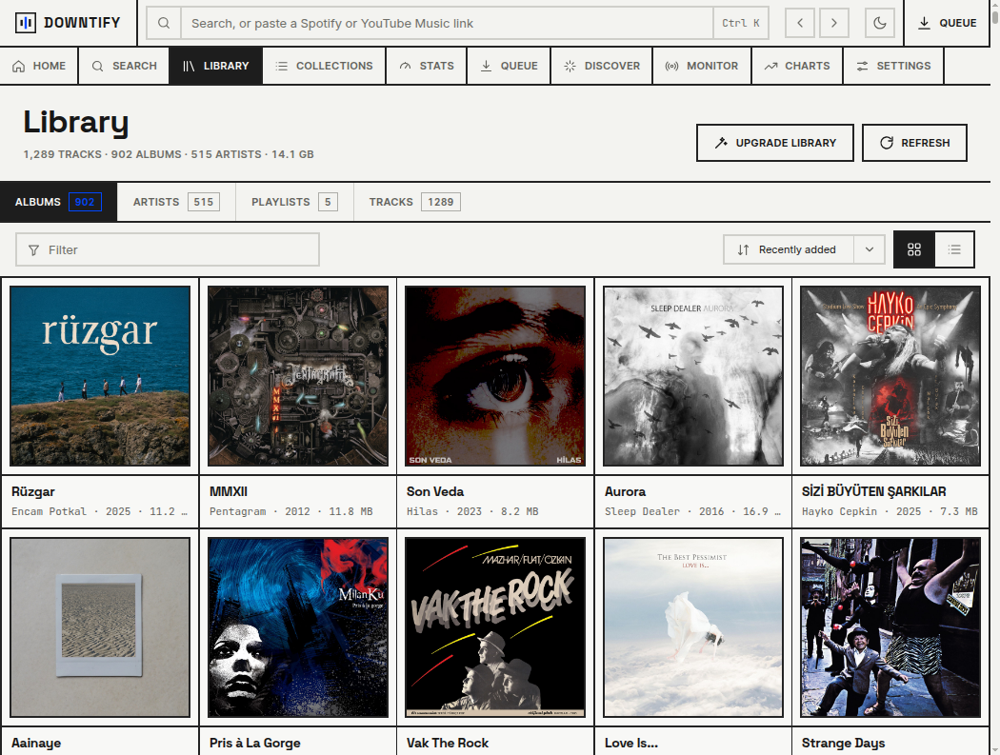
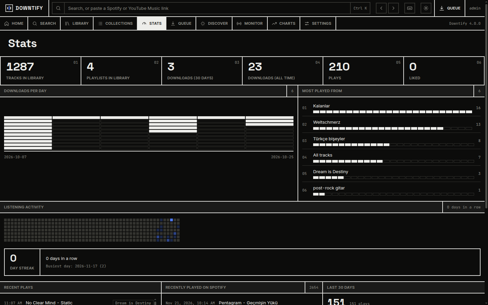

<p align="center">
  <picture>
    <source media="(prefers-color-scheme: dark)" srcset="assets/readme/wordmark-dark.svg">
    <source media="(prefers-color-scheme: light)" srcset="assets/readme/wordmark-light.svg">
    
  </picture>
</p>

<h3 align="center">A community fork of <a href="https://github.com/henriquesebastiao/downtify">Downtify</a> with a rebuilt newspaper-style interface and a set of features the original doesn't have.</h3>

<p align="center">
  Paste a Spotify, YouTube Music or Deezer link and get a perfectly tagged library, ready to play in your browser —
  <b>no Spotify account, no API keys, no Premium.</b>
</p>

<p align="center">
  <a href="https://github.com/henriquesebastiao/downtify"></a>
  <a href="LICENSE"></a>
</p>

<p align="center">
  <a href="#whats-different"><b>What's different</b></a> ·
  <a href="#the-v4-interface">Screenshots</a> ·
  <a href="#quick-start">Quick start</a> ·
  <a href="#credits">Credits</a>
</p>

<p align="center">
  
  <br><sub><b>Home</b> (light). A masthead instead of a sidebar, and one accent color instead of fifty shades of gray.</sub>
</p>

## What's different

The fork carries everything the original Downtify does — link pasting, YouTube Music matching, tagging, lyrics, the player, playlist monitoring — and adds on top:

Cross-device **Continue listening**, account-scoped listening time/completion/skip stats with 7/30/90-day periods, persistent download failures with retry/exclude, opt-in Spotify Sync auto-downloads, plus the fork's Collections, Smart Collections, notifications, storage tools, Spotify Mirror/Sync and Monitor.

<table>
<tr>
<td width="50%" valign="top">

### The v4 interface

<p align="center">
  
  <br><sub><b>Now Playing</b> (dark), with the 64-px transport strip pinned to the bottom of every page.</sub>
</p>

<p align="center">
  
  
  <br><sub><b>Library</b> (light) covers get their color back. <b>Stats</b> (dark) reads like a front page.</sub>
</p>

<p align="center">
  
  
  <br><sub><b>Collections</b> (light) group playlists behind one card. <b>Monitor</b> (dark) keeps its rows lean and its checks honest.</sub>
</p>

<p align="center">
  
  <br><sub><b>On a phone</b> (light), the strip collapses into a block menu and the masthead stacks.</sub>
</p>

The screenshots alternate between the light and the dark theme; every view has both. The design language is written down in [DESIGN.md](DESIGN.md): paper `#F3F3F0`, ink `#171717`, one accent `#0047FF`, 2-px hairlines, no radius, no shadows — Space Grotesk for display, Inter for text, JetBrains Mono for technical data.

## Quick start

You only need [Docker](https://docs.docker.com/get-docker/). The fork has no published image — build it from source:

```bash
git clone https://github.com/hereticloner/downtify-fork.git
cd downtify-fork
docker compose up -d --build downtify
```

Open **[localhost:8000](http://localhost:8000)**, sign in as **`admin`** / **`downtify`** and change that password in **Settings → General** (or turn accounts off with `DOWNTIFY_DISABLE_AUTH=true` on a server only you can reach). Your music lands in `docker/downloads`; the database and settings live in `docker/data`. Keep both on persistent storage.

Prefer official releases, one-click app store installs or ready-made multi-arch images? Use the **[original Downtify](https://github.com/henriquesebastiao/downtify#quick-start)** — this fork tracks upstream selectively, not release by release.

## What you can paste in

| Input | Example |
|-------|---------|
| Spotify track, album, playlist or artist | `open.spotify.com/track/…` |
| YouTube Music song, album, playlist or artist | `music.youtube.com/playlist?list=…` |
| YouTube video | `youtube.com/watch?v=…` |
| Deezer track, album, playlist or artist | `deezer.com/album/…` |
| Free-text search | `The Night Owls Do I Still Recall` |
| Library export (CSV) | Soundiiz, TuneMyMusic, Exportify |

The metadata comes from public pages, the audio from YouTube Music (YouTube as fallback) — never from Spotify, with no credentials of any kind. The full pipeline is in the upstream docs: [How it works](https://downtify.henriquesebastiao.com/how-it-works/).

## Documentation

Fork-specific features are documented in this repo, next to the code: [Collections](docs/features/collections.md), [Smart Collections](docs/features/smart-collections.md), [Stats](docs/features/stats.md), [Notifications](docs/features/notifications.md), [Storage](docs/features/storage.md), [Spotify Mirror](docs/features/spotify-mirror.md), [Spotify Sync](docs/features/spotify-sync.md), [Scrobbling](docs/features/scrobbling.md), [Monitor](docs/features/playlist-monitor.md).

Everything the fork shares with the original is documented upstream: [getting started](https://downtify.henriquesebastiao.com/getting-started/), [every feature](https://downtify.henriquesebastiao.com/features/), [troubleshooting](https://downtify.henriquesebastiao.com/troubleshooting/), [API reference](https://downtify.henriquesebastiao.com/api-reference/).

The upstream mobile apps speak the same API and work against this fork: [Downtify for Android](https://github.com/henriquesebastiao/downtify-android) and [Downtify for iOS](https://github.com/michaelmoskie/Downtify-IOS-Client).

## Credits

This fork exists because [Henrique Sebastião](https://github.com/henriquesebastiao) built and maintains [Downtify](https://github.com/henriquesebastiao/downtify) in the open, along with its [35+ contributors](https://github.com/henriquesebastiao/downtify/graphs/contributors). The upstream project is where general features, bug reports and translations belong — and where to [star the repository](https://github.com/henriquesebastiao/downtify) or [sponsor its development](https://github.com/sponsors/henriquesebastiao) if Downtify has earned a place on your server.

Issues and pull requests that concern this fork's own features — the v4 interface, Collections, Stats, the rest of the list above — are welcome here.

## License

Licensed under [AGPL-3.0](LICENSE), like the project it comes from.

> [!WARNING]
> Users are responsible for their actions and any legal consequences. Downtify does not support unauthorized downloading of copyrighted material and takes no responsibility for user actions.
